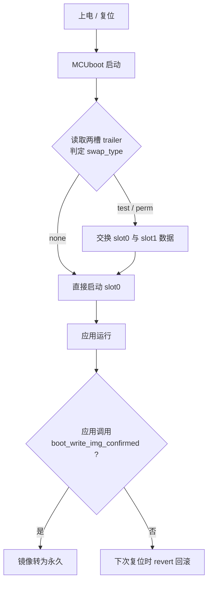

# Zephyr + MCUboot 双槽固件升级与自动回滚

在 STM32H563ZI（NUCLEO-H563ZI）上，基于 **Zephyr sysbuild + MCUboot** 实现的双槽（A/B）固件升级演示：

- 新固件写入备份槽（slot1），不破坏正在运行的固件
- MCUboot 在下次启动时交换两槽数据并**试运行**新固件
- 应用自检通过后调用确认接口，新固件转为永久
- **若未确认，下次启动自动回滚到旧固件**，保证设备不会变砖

> 这是一个用于学习 MCUboot 机制的可运行工程，不是量产固件。当前升级包由 PC 通过 STM32CubeProgrammer 定点写入备份槽，**尚未实现设备侧接收升级包**（见「后续计划」）。

---

## 1. 硬件与环境

| 项目 | 版本 |
| --- | --- |
| 开发板 | NUCLEO-H563ZI（STM32H563ZI，Cortex-M33，2 MB Flash，8 KB 擦除扇区） |
| 串口 | USART3 → ST-Link 虚拟串口，115200 8N1 |
| RTOS | Zephyr `v4.4.0-14354-g434233e9751e` |
| 工具 | west 1.5.0、Zephyr SDK 1.0.1、CMake 3.28+ |
| Bootloader | MCUboot（随 Zephyr 工作区提供），RSA-2048 **开发用密钥** |

---

## 2. 目录结构

本仓库只包含**应用工程**，Zephyr 与 MCUboot 由 west 工作区提供（不纳入版本管理）。

```text
.
├── CMakeLists.txt     # 标准 Zephyr 应用，sysbuild 按目录名注册为镜像 mcuboot_ab
├── prj.conf           # 基础配置 + A 版本号 v1.0.0
├── prj_b.conf         # B 版本号 v1.1.0（叠加在 prj.conf 之上）
├── src/main.c         # 应用：LED 心跳 + 串口 'u' 触发升级请求 + 启动确认
└── .gitignore
```

---

## 3. Flash 分区

由板级 devicetree 定义（`nucleo_h563zi-common.dtsi`），bootloader、应用、签名工具三处共用同一份分区表。

| 区域 | 起始地址 | 大小 | 说明 |
| --- | --- | --- | --- |
| `boot_partition` | `0x0800_0000` | 64 KB | MCUboot，复位向量所在处，永不移动 |
| `slot0_partition` (image-0) | `0x0801_0000` | 960 KB | 应用启动槽 |
| `slot1_partition` (image-1) | `0x0810_0000` | 960 KB | 备份/升级槽 |
| `storage_partition` | `0x081F_0000` | 64 KB | 板级预留，本工程未使用 |

镜像内部还有 `0x400` 字节的 MCUboot 镜像头（magic `0x96f3b83d`、版本、长度、TLV 签名），因此代码实际入口是槽基址 + `0x400`。

> ⚠️ **本板默认交换模式为 `SWAP_USING_OFFSET`**（板级 DTS 没有 scratch 分区）。该模式下 **slot1 的第一个扇区被交换算法占用**，升级包必须写入 `0x0810_0000 + 0x2000 = 0x0810_2000`。写错地址时 MCUboot 会报：
>
> ```text
> E: Secondary header magic detected in first sector, wrong upload address?
> ```

---

## 4. 工作机制



四种状态：

| 升级请求 | 应用是否确认 | 结果 |
| --- | --- | --- |
| 无 | — | 一直运行 slot0 |
| `boot_request_upgrade(false)`（TEST） | 未确认 | 试运行一次，下次复位自动回滚 |
| `boot_request_upgrade(false)`（TEST） | 已确认 | 永久保留新固件 |
| `boot_request_upgrade(true)`（PERMANENT） | — | 直接永久，无回滚窗口 |

关键点：**MCUboot 的跳转地址是编译期常量，永远跳 slot0**（`chainload address offset: 0x10000`）。"切到新固件"是通过**交换两槽数据**实现的，不是改跳转目标——因为应用只链接到 slot0 的地址。

---

## 5. 关键配置

`prj.conf`：

```conf
CONFIG_GPIO=y

# 应用需要自己写 Flash（写 trailer / 后续写升级包）
CONFIG_FLASH=y
CONFIG_FLASH_MAP=y
CONFIG_STREAM_FLASH=y
CONFIG_IMG_MANAGER=y

CONFIG_MCUBOOT_IMGTOOL_SIGN_VERSION="1.0.0+0"
```

> 若缺少 `IMG_MANAGER` 那几项，`boot_request_upgrade()` 等接口无法工作，生成的 `.config` 里连 `CONFIG_FLASH` 都不会有。

`prj_b.conf`（只放与 A 不同的项，叠加使用）：

```conf
CONFIG_MCUBOOT_IMGTOOL_SIGN_VERSION="1.1.0+0"
```

构建时 sysbuild 自动选用：`SB_CONFIG_BOOTLOADER_MCUBOOT=y`、`SB_CONFIG_MCUBOOT_MODE_SWAP_USING_OFFSET=y`。

---

## 6. 构建与验证

以下命令在 west 工作区根目录执行，`<repo>` 指本仓库路径。

### 6.1 编译 A（v1.0.0）

```bash
west build -b nucleo_h563zi --sysbuild <repo> -d build_a -- "-DSB_CONFIG_BOOTLOADER_MCUBOOT=y"
```

产物：`build_a/mcuboot_ab/zephyr/zephyr.signed.bin`（注意 sysbuild 下产物在**镜像子目录**里，不在 `build_a/zephyr/`）。

### 6.2 编译 B（v1.1.0）

```bash
west build -b nucleo_h563zi --sysbuild <repo> -d build_b \
  -- "-DSB_CONFIG_BOOTLOADER_MCUBOOT=y" "-DEXTRA_CONF_FILE=prj_b.conf"
```

验证签名版本：

```bash
grep -o "imgtool.py sign --version [0-9.]*" build_b/mcuboot_ab/build.ninja
```

### 6.3 烧录 A

```bash
west flash -d build_a
```

### 6.4 把 B 写入备份槽（不擦除、不写状态）

```bash
west flash -d build_b/mcuboot_ab --download-address 0x08102000
```

> Windows PowerShell 下请给每个 `-D...` 参数**整体加引号**，否则 `prj_b.conf` 会被拆成 `prj_b` 和 `.conf` 两个参数。

### 6.5 触发升级

1. 串口看到 `A: press 'u' + Enter to request upgrade from slot1`
2. 输入 `u`，应用打印 `boot_request_upgrade() -> 0 (0 = OK)`
3. 按复位键

---

## 7. 实测日志

**TEST 升级交换成功：**

```text
I: Secondary image: magic=good, swap_type=0x2, copy_done=0x3, image_ok=0x3
I: Starting swap using offset algorithm.
I: Image index: 0, Swap type: revert
I: Bootloader chainload address offset: 0x10000
I: Image version: v1.1.0
```

**未确认，复位后自动回滚：**

```text
I: Image index: 0, Swap type: revert
I: Starting swap using offset algorithm.
I: Image version: v1.0.0
```

> 复现回滚：注释掉 `main.c` 中的 `boot_write_img_confirmed()` 后重新编译 B 并写入 slot1，触摸 'u' 升级，再复位一次即可看到自动回滚。当前源码默认保留该调用。

日志字段速查：

| 字段 | 含义 |
| --- | --- |
| `magic` | `unset` 无人请求升级 / `good` 已请求 |
| `swap_type` | `0x1 none` / `0x2 test` / `0x3 perm` / `revert` |
| `image_ok` | `SET` 已确认 / `UNSET` 未确认 |
| `Image version` | 实际启动的版本（判断 A/B 的唯一依据） |

---

## 8. 踩坑记录

1. **sysbuild 产物路径**：每个镜像一个子目录（`build/<镜像名>/zephyr/`），根目录的 `build/zephyr/` 只有配置。
2. **offset 模式的写入地址**：slot1 镜像要从 `+8 KB` 开始（`0x0810_2000`），照抄 scratch/move 模式的教程会直接失败。
3. **Kconfig 依赖**：应用默认不能写 Flash，需要 `FLASH / FLASH_MAP / STREAM_FLASH / IMG_MANAGER` 四项。
4. **版本号配置拼写**：`CONFIG_MCUBOOT_IMTOOL_SIGN_VERSION` 少写一个 `G` 不会报错，只会静默失效、版本停在 `0.0.0+0`。
5. **PowerShell 参数拆分**：`-DEXTRA_CONF_FILE=prj_b.conf` 需要整条加引号；而 `STM32_Programmer_CLI -e [...]` 反而要把方括号和地址拆成独立参数。

---

## 9. 后续计划

- [ ] 设备侧接收升级包：用 `flash_img_init_id()` + `flash_img_buffered_write()` 把串口收到的数据流式写入 slot1，替代手工定点烧写
- [ ] 传输层替换为 CAN，实现「上位机 → CAN → 设备写备份槽 → 请求切换 → 确认/回滚」的完整 OTA 链路
- [ ] 升级失败注入测试（篡改镜像、断电中断交换），验证恢复能力

---

## 参考

- Zephyr Bootloader: <https://docs.zephyrproject.org/latest/develop/bootloader/index.html>
- MCUboot: <https://docs.mcuboot.com/>
